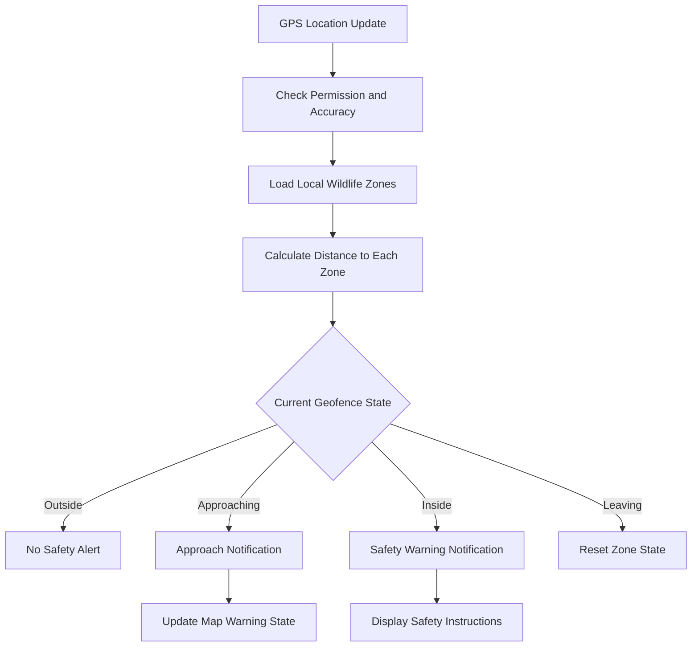
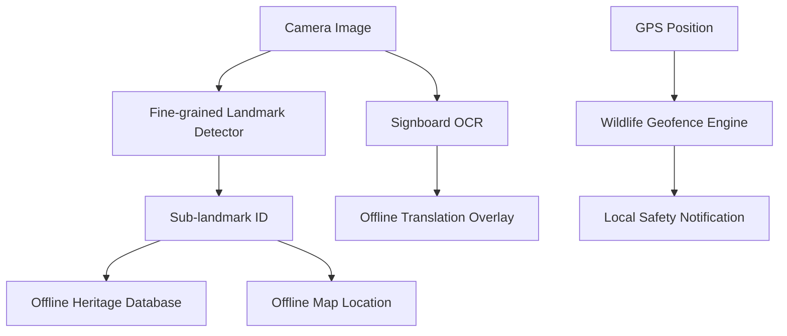

# HeritageAR Feature Description

## Offline Map with Wildlife Alert Service and Offline AR Signboard Translation

### Project Context

HeritageAR is an offline-first mobile application for intelligent cultural heritage exploration. The main research contribution is fine-grained landmark and sub-landmark detection. The system identifies specific heritage features, retrieves locally stored information, displays the visitor's location on an offline map, translates signboards using the mobile camera, and provides safety alerts near known wildlife warning areas.

These features are designed for heritage locations where mobile network coverage may be unreliable. Core data processing is performed on the device using locally bundled geographic data, databases, machine-learning models, OCR, and translation resources.

---

# 1. Offline Map with Wildlife Alert Service

## 1.1 Feature Overview

The offline map provides a digital representation of the heritage site without requiring an active internet connection. It displays important landmarks, sub-landmarks, walking paths, facilities, viewpoints, and wildlife warning areas.

The map is designed to support visitors before and during exploration. It helps users understand the spatial relationship between heritage locations and provides safety information when the visitor approaches an area where elephant activity or Asian giant honeybee activity has been reported.

The map currently focuses on the Sigiriya heritage area and contains locations such as:

- Ticket Counter
- Water Gardens
- Boulder Gardens
- Terraced Gardens
- Mirror Wall
- Fresco Gallery
- Lion's Paws
- Audience Hall
- Summit Palace
- Sigiriya Museum
- Pidurangala Rock

## 1.2 Purpose and Objectives

The objectives of the offline map are:

1. To provide map access without internet connectivity.
2. To display fine-grained heritage landmarks and sub-landmarks.
3. To support offline visitor navigation.
4. To show the relationship between detected landmarks and their geographic locations.
5. To display wildlife warning areas.
6. To provide location-based safety notifications.
7. To reduce dependence on online map services.
8. To protect user location data by processing it locally.

## 1.3 Offline Map Data

The map uses a locally bundled GeoPackage file containing geographic features. The GeoPackage can contain point, line, and polygon data, including roads, paths, buildings, water features, and points of interest.

The map data is copied from the application assets into local device storage and read using a local SQLite-compatible database. Since the map file is included in the application package, the map does not need to download online map tiles during normal use.

The offline map contains the following data layers:

### Base geographic layer

This layer contains:

- Roads
- Walking paths
- Water features
- Buildings
- Site-related polygons
- Geographic reference features

### Heritage landmark layer

This layer contains curated heritage locations that may not always have complete or consistent names in open geographic datasets. Curated locations include the main visitor trail from the Ticket Counter to the Summit Palace.

### Facility and visitor-service layer

This layer can contain:

- Museums
- Bus stations
- Restaurants
- Hotels
- Parking areas
- Visitor facilities
- Rest areas

### Wildlife warning layer

This layer displays approximate locations where wildlife or insect activity has previously been observed or reported.

## 1.4 Map Interaction

The user can interact with the map using:

- Zooming
- Panning
- Tapping a landmark marker
- Selecting map categories
- Viewing landmark information
- Viewing wildlife safety information
- Checking the current location
- Viewing warning overlays

Map categories may include:

- Landmarks
- Hotels
- Food
- Facilities
- Viewpoints
- Elephant Warning
- Honeybee Warning
- All Features

Marker clustering and label decluttering are used to keep the map readable when many locations are close together. This is important at Sigiriya because several sub-landmarks are located within a small area on the rock.

## 1.5 Wildlife Warning Areas

The map contains two main warning categories.

### Elephant activity warning areas

Elephant areas are represented using approximate geographic coordinates and warning radii. These areas indicate locations where wild elephant activity has been observed or reported.

The map should use careful wording. It should not state that an elephant is currently present. The correct interpretation is that the location is a reference warning area.

Recommended message:

> Wild elephant activity has been reported in this area. Stay with your group, maintain a safe distance, and follow official instructions.

### Asian giant honeybee warning stretch

The upper Sigiriya climb contains a warning stretch associated with reported Asian giant honeybee activity. Visitors may refer to these insects as wasps or hornets, but Asian giant honeybees are a more scientifically appropriate description.

The warning stretch may include:

- Terraced Gardens
- Fresco Gallery
- Mirror Wall
- Lion's Paw platform
- Summit staircase

Recommended safety message:

> You are approaching an Asian giant honeybee warning stretch. Keep silent, avoid sudden movements, do not hit the railings, and follow staff instructions.

## 1.6 Wildlife Alert Service

The wildlife alert service is implemented as an offline foreground GPS monitor. It monitors the user's location while the offline map is open and compares each suitable GPS update with the warning areas stored in the application assets. No remote server is required for warning-zone loading, distance calculation, or notification generation.

The implementation is provided by `frontend/lib/core/location/wildlife_alert_service.dart` and uses `flutter_local_notifications` with the existing `geolocator` package.

The alert service contains the following components:

### Wildlife zone repository

Loads warning zones from the bundled `assets/vectors/sigiriya_wildlife_areas.json` file. Elephant areas are loaded as circular zones, while the Asian giant honeybee warning stretch is loaded as a line and evaluated using the shortest distance from the visitor to each line segment.

Each warning zone should contain:

- Zone ID
- Zone name
- Hazard type
- Latitude
- Longitude
- Warning radius
- Severity
- Description
- Safety instructions
- Data source
- Verification status

### Geofence monitor

Receives GPS position updates using `geolocator` and calculates the distance between the visitor and each warning zone. The current implementation requests high-accuracy location updates with a 10-metre distance filter.

### Alert state manager

Tracks whether the visitor is:

- Outside the zone
- Approaching the zone
- Inside the zone
- Leaving the zone
- In an unknown location because GPS accuracy is poor

### Local notification service

Displays notifications on the device without requiring a remote server. Android notifications use high importance, high priority, sound, and vibration. iOS and macOS notification sound presentation is also enabled where supported.

The Android manifest includes the `POST_NOTIFICATIONS` permission required by Android 13 and later. Location and notification permissions are requested when the user opens the map, rather than during application startup.

## 1.7 Alert State Workflow



The implemented system uses separate approach, warning, and exit distances. The warning radius is loaded from the local warning-area data. An additional approach band of 80 metres is used before the warning radius, and a 30-metre exit hysteresis is used to avoid rapid state changes caused by GPS movement.

The system uses the following states:

- Outside: the visitor is beyond the warning area.
- Approaching: the visitor is within the approach band.
- Inside: the visitor is within the warning radius.
- Leaving: the visitor must move beyond the exit radius before the zone is reset.

The elephant warning radius is read from the local JSON dataset. The honeybee line uses a 35-metre warning distance because it represents a narrow trail stretch rather than a circular area.

The conceptual distance bands are:

- Far: more than 200 metres from an elephant warning area
- Approaching: between 100 and 200 metres
- Inside: within 100 metres

The values are configurable in the alert service and local warning-zone dataset. The honeybee stretch uses a smaller distance because it follows a narrow trail section.

## 1.8 Notification Rules

The implemented service follows these rules:

1. Notify the user once when approaching a warning area.
2. Notify the user again when entering the warning radius.
3. Do not repeat the same notification continuously.
4. Suppress repeated approach notifications for the same map session.
5. Reset the alert only after the user leaves the exit radius.
6. Check GPS accuracy before issuing a high-priority alert.
7. Use the platform notification sound and vibration for the entry alert.

When the user first enters the approach band, an approach notification is issued. When the user crosses into the warning radius, a stronger entry notification is issued. The entry event is not suppressed by the earlier approach event. After the user leaves the exit radius, the zone state is reset so it can alert again during a later visit.

### Example elephant notification

Title:

> Elephant activity warning

Message:

> You are approaching an area where elephant activity has been reported. Stay with your group and follow official instructions.

### Example honeybee notification

Title:

> Asian giant honeybee warning

Message:

> You are entering the upper-climb warning stretch. Keep silent and avoid sudden movement.

## 1.9 Foreground and Background Operation

Foreground operation is implemented. When the offline map is open, the application starts the wildlife monitor, receives GPS updates, shows an in-app warning banner, and sends a local notification with sound and vibration.

Background operation is more complex because Android and iOS can restrict continuous location access to protect battery life and privacy. Background alerts may require additional permissions and native platform configuration.

The current implementation stops monitoring when the map screen is closed. Alerts while the application is fully minimized or terminated are not yet implemented. Background geofencing can be considered as a future enhancement after real-device testing and additional Android/iOS configuration.

## 1.10 Privacy and Safety Considerations

The application should process location data locally whenever possible. It should not transmit the user's GPS coordinates to an external server unless the user has explicitly consented.

The following disclaimer should be visible in the map or notification settings:

> Wildlife warning areas are approximate reference areas based on reported or observed activity. They do not represent live animal tracking or guaranteed animal locations.

## 1.11 Benefits

The offline map and alert service provide:

- Operation without internet connectivity
- Improved visitor safety
- Offline access to heritage locations
- Spatial understanding of fine-grained landmarks
- Location-aware historical exploration
- Reduced dependence on printed maps
- Reduced privacy risk
- Integration with offline AR navigation

## 1.12 Limitations

The main limitations are:

- GPS accuracy may decrease near rocks, trees, and buildings.
- Wildlife warning areas are approximate.
- The system does not track live animals.
- Continuous GPS monitoring can consume battery power.
- Monitoring currently runs while the offline map screen is open; fully background alerts are not yet implemented.
- The current map coverage is mainly focused on Sigiriya.
- Field testing is required to measure alert accuracy.

## 1.13 Research Contribution

This feature contributes to the research by combining offline geographic information, fine-grained landmark visualization, GPS-based geofencing, and local visitor safety notifications.

It transforms the landmark-recognition system from a camera-only application into a location-aware heritage exploration platform.

---

# 2. Offline AR Signboard Translation Layer

## 2.1 Feature Overview

The offline AR signboard translation layer allows visitors to point the mobile camera at a heritage signboard and receive a translated version of the detected text.

The feature combines camera input, on-device optical character recognition, heritage phrase matching, offline translation resources, confidence scoring, and camera-based text overlays.

It can assist visitors with:

- Direction signs
- Safety instructions
- Conservation notices
- Museum information
- Heritage descriptions
- Visitor rules
- Sinhala, Tamil, and English signs

## 2.2 Purpose and Objectives

The objectives of the offline AR signboard translator are:

1. To recognize text from physical heritage signboards.
2. To translate signboard content without continuous internet access.
3. To support local and international visitors.
4. To translate safety instructions quickly.
5. To preserve user privacy by processing images locally.
6. To combine OCR and translation with an augmented camera view.
7. To provide a domain-specific solution for heritage locations.

## 2.3 Translation Workflow


The translation process is as follows:

1. The user opens the AR translator.
2. The rear camera displays the signboard.
3. The user captures an image.
4. On-device OCR detects text lines.
5. OCR returns text and bounding-box coordinates.
6. Detected lines are grouped into a readable text block.
7. The system identifies the source language.
8. The heritage knowledge base is searched for a known phrase.
9. An on-device translation model is used if available.
10. The local dictionary is used when model translation is unavailable.
11. The system calculates a confidence value.
12. The translated text is rendered over the original signboard region.

## 2.4 Translation Layers

### Layer 1: Heritage phrase matching

The first layer searches a local heritage translation dataset. This is important because many heritage signs contain repeated and predictable phrases.

Example phrases include:

- Main Entrance
- Ticket Counter
- Water Gardens
- Mirror Wall
- Lion's Paw
- Keep Silence
- Do Not Touch
- Do Not Enter
- Photography Prohibited
- Beware of Wasps
- No Littering

Known phrases can be translated with high confidence because their translations are manually curated and associated with a source or review status.

### Layer 2: On-device translation model

If the phrase is not found in the heritage knowledge base, the application can use an on-device translation model. Once the required language models are available on the device, the translation can be performed without sending text to a cloud service.

The interface should show whether a language model is:

- Downloading
- Ready
- Unsupported
- Failed
- Using dictionary fallback

### Layer 3: Offline dictionary

The local dictionary provides word-level and phrase-level fallback translation. It can support:

- English-to-target translation
- Target-language-to-English translation
- Common heritage vocabulary
- Partial translation
- Pivot translation through English

Dictionary translation should be clearly identified because it may not preserve full sentence grammar.

## 2.5 Camera and OCR Processing

The translator uses a rear camera and captures a still image for processing. The image is passed to the on-device OCR engine.

The OCR stage returns:

- Recognized text
- Text lines
- Text blocks
- Bounding boxes
- Reading order information

The application combines related lines into a single translation candidate. This prevents a long signboard from being translated as many unrelated fragments.

The captured image is frozen while the text is processed. This gives the user a stable background for reading the translated overlay.

## 2.6 AR Overlay

The translated text is positioned using the OCR bounding box of the original text. The overlay can display:

- Original text
- Translated text
- Target language
- Confidence value
- Translation method
- Offline or model status
- Retry and close actions

Example:

```text
ORIGINAL
Keep Silence

SINHALA TRANSLATION
Nishshabdathawa surakinna

STATUS
Verified heritage phrase
```

For Sinhala, Tamil, Hindi, and Chinese, the user interface should provide sufficient line height and font space because these scripts may contain stacked marks, conjunct characters, and complex glyph structures.

## 2.7 Confidence and Result Types

The translator should distinguish between the following result types:

| Result type | Description |
|---|---|
| Verified heritage phrase | Matched against a curated local phrase dataset |
| Offline model translation | Generated by an on-device translation model |
| Dictionary translation | Generated using local vocabulary |
| Partial translation | Only some words were translated |
| Unsupported | No reliable offline translation was available |

Suggested confidence interpretation:

- 0.90-1.00: verified phrase or highly reliable result
- 0.75-0.89: on-device model translation
- 0.40-0.74: partial or dictionary translation
- Below 0.40: show a warning or request another capture

The application should not display an uncertain dictionary result as if it were a verified professional translation.

## 2.8 Offline Operation

The heritage knowledge base and general dictionary are bundled with the application. Some on-device translation models may need to be downloaded once before they can operate offline.

The accurate technical description is:

> The translator performs OCR and translation locally without transmitting signboard images or recognized text to a remote server after the required language resources are available on the device.

This means the feature is offline during normal operation after model preparation. It is not necessarily completely offline from the first installation if a language model must be downloaded at runtime.

## 2.9 Sinhala and Multilingual OCR Limitation

A major limitation is that the current OCR pipeline is primarily configured for Latin-script recognition. Sinhala phrase data and a Sinhala OCR asset are present, but this does not yet provide a complete general-purpose Sinhala OCR engine.

Consequently:

- English signboards are expected to have stronger recognition accuracy.
- Known Sinhala phrases can be translated if they are recognized or matched.
- Arbitrary Sinhala text may not be recognized reliably.
- Tamil, Hindi, and Chinese recognition require separate validation.
- Dictionary translation cannot correct text that OCR failed to recognize.

For a stronger research implementation, the system should use script detection followed by script-specific OCR models.

## 2.10 Recommended OCR Improvement Roadmap

### Stage 1: Heritage phrase classification

Create image classes for common signboards such as:

- Main entrance
- Ticket counter
- Keep silence
- Do not touch
- Beware of honeybees
- Photography prohibited
- Do not enter
- No littering

This approach is suitable for a controlled heritage-site application.

### Stage 2: Sinhala and Tamil text-line recognition

Develop or integrate OCR models trained using:

- Real signboard images
- Different lighting conditions
- Multiple fonts
- Weathered text
- Perspective distortion
- Blurred images
- Sinhala diacritics
- Mixed-language signs

### Stage 3: General multilingual OCR

Add a script-classification stage that selects the appropriate OCR branch for Sinhala, Tamil, English, Hindi, or Chinese text.

## 2.11 Image Quality Handling

Before OCR, the application should evaluate:

- Brightness
- Blur
- Focus
- Text size
- Camera angle
- Perspective distortion
- Signboard visibility

If the image quality is too low, the application can display guidance such as:

- Move closer to the sign.
- Hold the phone steady.
- Improve the lighting.
- Point the camera directly at the sign.
- Capture the complete text area.

This can improve user experience and reduce unsuccessful OCR attempts.

## 2.12 Camera Overlay AR versus Spatial AR

The current feature is best described as:

> Offline camera-based AR signboard translation.

It is an augmented camera overlay because translated text is rendered over the captured camera image. It is not yet full spatial AR because it does not continuously anchor text to a physical signboard using ARCore or ARKit.

A future spatial AR version could include:

- Continuous camera-frame processing
- ARCore tracked-image detection
- Plane detection
- Perspective-correct text placement
- Stable text tracking while the user moves
- Physical signboard anchors

## 2.13 Benefits

The offline AR signboard translator provides:

- Language assistance without continuous internet access
- Improved accessibility for local and international visitors
- Privacy-preserving image processing
- Faster understanding of safety instructions
- Support for multilingual cultural education
- Domain-specific heritage vocabulary
- Integration with fine-grained landmark recognition

## 2.14 Limitations

The main limitations are:

- Sinhala OCR requires further development.
- Translation model availability depends on local model preparation.
- Poor lighting or blur can reduce OCR accuracy.
- Angled signboards may produce incorrect bounding boxes.
- Long signs can increase processing time.
- Dictionary translation may be grammatically incomplete.
- The current overlay is camera-based rather than continuously spatially anchored.

## 2.15 Research Contribution

This feature contributes to the research by combining on-device OCR, heritage-domain phrase recognition, offline multilingual translation, confidence scoring, and augmented camera overlays.

It extends fine-grained landmark detection from recognizing physical structures to interpreting the information and safety signs located around those structures.

---

# 3. Integration with Fine-Grained Landmark Detection

The two features support the main research contribution rather than operating as unrelated features.

Example workflow:

1. The camera detects `sigiriya_mirror_wall` using the fine-grained landmark model.
2. The application retrieves the Mirror Wall record from the local database.
3. The offline map highlights the corresponding landmark location.
4. The AR interface displays historical information.
5. The signboard translator reads nearby safety or heritage text.
6. The GPS service checks whether the visitor is near the honeybee warning stretch.
7. The notification service issues a local safety alert when necessary.



This creates a complete offline heritage exploration pipeline:

> Fine-grained visual recognition + offline spatial mapping + offline multilingual interpretation + location-aware visitor safety.

---

# 4. Evaluation Metrics

## 4.1 Offline Map Metrics

The offline map can be evaluated using:

- Map loading time
- Map rendering time
- Offline availability rate
- GPS position accuracy
- Marker accuracy
- Geofence detection delay
- False warning rate
- Missed warning rate
- Battery consumption
- Memory usage
- User usability score

## 4.2 Alert Service Metrics

The alert service can be evaluated using:

- Notification precision
- Notification recall
- Alert latency
- Duplicate notification rate
- False entry rate caused by GPS drift
- Missed entry rate
- Battery consumption
- User acknowledgement rate

## 4.3 AR Translator Metrics

The translator can be evaluated using:

- Character recognition accuracy
- Word recognition accuracy
- Phrase recognition accuracy
- Translation accuracy
- Heritage phrase matching accuracy
- Bounding-box alignment accuracy
- Overlay intersection-over-union
- Capture-to-result latency
- Offline success rate
- Accuracy under low light
- Accuracy under blur
- Separate accuracy for Sinhala, Tamil, and English

## 4.4 Fine-Grained Detection Metrics

The main landmark model should continue to be evaluated using:

- Per-class precision
- Per-class recall
- F1 score
- Confusion matrix
- Mean Average Precision
- Detection confidence
- Inference latency
- Frames per second
- False positives between visually similar sub-landmarks

---

# 5. Overall Feature Summary

The offline map with wildlife alerts and the offline AR signboard translator strengthen HeritageAR as an intelligent, privacy-preserving, and network-independent heritage exploration platform.

The offline map provides geographic context and safety awareness. The alert service warns users when they approach reported wildlife or insect hazard areas. The AR signboard translator helps visitors understand local signs and heritage information through on-device OCR and translation.

Together, these features support the project's main novelty:

> HeritageAR is an offline intelligent heritage exploration system that combines fine-grained landmark detection, locally stored geographic information, GPS-based wildlife safety alerts, and camera-based multilingual signboard translation.

The system is especially suitable for heritage environments where internet access may be unreliable, where visitors need multilingual assistance, and where privacy-preserving on-device processing is important.
